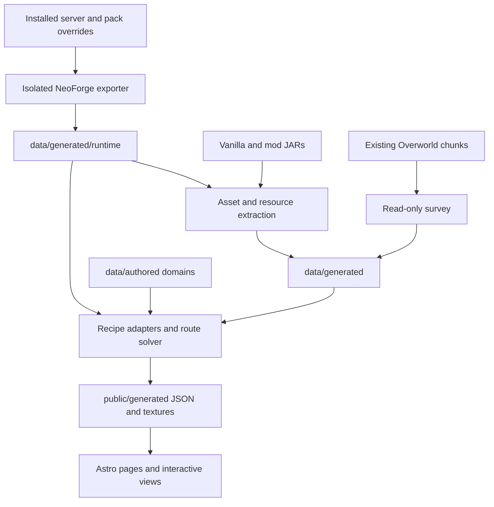

# Data pipeline

The app builds a local snapshot from registered Minecraft content, JAR resources,
editable YAML and an optional survey of existing chunks. The browser reads static
JSON and images; it does not query the playing server.

## Registered content

[`scripts/runtime.py`](../../../web/scripts/runtime.py) compiles
[`AtlasExporter.java`](../../../web/tools/exporter/AtlasExporter.java) against the installed
server libraries, then boots a disposable NeoForge server under `.cache/audit-server`.
It uses the installed server's mod set and checked maintained resource JARs.
Config is copied from the server and common overrides; existing-world
`serverconfig` is copied as configuration only. Live chunks, player data and LODs
are never mounted. Java libraries and mod JARs are symlinked as read-only inputs
by convention; this is process isolation, not an operating-system sandbox.

The exporter captures registries, resolved RecipeManager recipes, tags, loot,
advancements, fluids and targeted Java interaction adapters. Runtime resource
provenance distinguishes active resources from competing raw JAR definitions.
The exporter waits for the first completed server tick, after startup listeners,
and allows five ticks for fixture cleanup before stopping. The isolated BlueMap
webserver, asset downloads and metrics are disabled. `complete.json` marks a
finished export; `scripts/runtime_capture.py` accepts it only after clean process
exit and rejects fatal shutdown diagnostics even with exit code zero. Failed or
timed-out runs remove the marker. `snapshot.json` records loaded JAR hashes, the
pack-lock hash and input fingerprint after that check. Investigate a failed capture
before compiling its output.

The adapter is specific to this pack and Minecraft 1.21.1 / NeoForge. Adding a mod
can require new Java or graph adapters. User-world datapacks and gamerules are not
imported. The disposable world can persist between captures; its state is not
an observation of the playing world.

## Runtime compatibility and weight coverage

Create Sky Compat's Analog Audio adapter changes startup registration only. It
adds no recipes, acquisition routes, textures or mass values for the Atlas to
project. Pack resource fixes remain inputs to the existing runtime exporter and
asset extraction; their generated projections must not be edited by hand.

The Atlas does not currently export Sable block mass or assembled-ship weight.
Its weighted loot outcomes and world-survey estimates are unrelated to physics.
Use the [building-weight guide](../weights.md) for that policy and its native
checks. Do not infer ship weight from item or recipe records.

After updating the installed dependency set, refresh the runtime snapshot and
extraction, compile, then run `pnpm data:check`. Confirm the loaded JAR hashes in
`runtime/snapshot.json`; a newer pack lock or Compat source checkout is not
evidence that the exporter loaded it. Keep an older capture's provenance and
stale indication until its inputs can be refreshed. Runtime refresh does not
replace the separately dated world, island or structure surveys.

## Textures and names

[`scripts/extract.py`](../../../web/scripts/extract.py) reads the configured vanilla client
JAR, `pack/mods`, common override JARs and nested JARs. It indexes resource JSON and
English translations. For duplicate asset paths, later scanned files replace
earlier files; this scanner order does not reproduce every client resource-pack
priority rule. User-selected resource packs are not scanned.

For each registered item it follows the item model's parent chain and resolves
texture aliases. Static `item/generated` models with two to five complete, square,
equal-sized layers are composited in layer order by
[`item_icons.py`](../../../web/scripts/item_icons.py). The resulting content-hashed
SVG embeds unchanged PNG bytes and records each source. Custom loaders, geometry,
animated textures and incomplete layers retain the single-texture fallback.

That fallback selects an available PNG: `layer0`, `all`, `front`, `side`,
`top`, `particle`, then other texture entries. The bytes are copied unchanged to
`public/generated/icons/<content-hash>.png`; identical textures share a file.
Each icon retains its JAR and resource path. Names come from `en_us` translations,
with an identifier-based fallback. Matching Ponder translation text is indexed;
Ponder scenes are not executed.

These are texture previews, not Minecraft inventory renders. Model geometry,
tints, animation timing, state-dependent overrides and custom renderers are not
reproduced. Layer compositing alone does not reproduce runtime tinting.
Missing models/textures use the grid's placeholder. Old unused icon files can
remain after extraction; generated assets are rebuildable and excluded from Git.

## Ownership

| Location                          | Authority and editing                                                                        |
| --------------------------------- | -------------------------------------------------------------------------------------------- |
| `data/authored/acquisition.yml`   | Environment gates, gathering, farming, special interactions and classifications              |
| `data/authored/items.yml`         | Item notes, overlap opportunities, unresolved decisions                                      |
| `data/authored/recipes.yml`       | Full recipe replacements or disable operations; scenario until tested                        |
| `data/authored/interactions.yml`  | Reviewed mechanics and explicitly assumed gathering routes                                   |
| `data/authored/mobs.yml`          | Mob behavior, Hostile Skies architecture and settings                                        |
| `data/authored/progression.yml`   | Gathering roots, machine requirements and graph assumptions                                  |
| `data/authored/worldgen.yml`      | Geography interpretation and generation decisions                                            |
| `data/authored/configuration.yml` | Design constraints, coverage limits and operational findings                                 |
| `data/authored/resourcepacks.yml` | Resource-pack judgments and next playtests; edited directly, outside the map scenario editor |
| `data/research/resourcepacks/`    | Dated catalog metadata, selected file inspections and source gallery links                   |
| `data/generated/runtime/`         | Exact registered game evidence; never hand-edit                                              |
| `data/generated/world.json`       | Read-only Anvil survey and sampling method                                                   |
| `data/generated/documents.json`   | All discovered JAR resource versions and provenance                                          |
| `public/generated/`               | Rebuildable browser projection and extracted game textures                                   |
| `tools/exporter/`                 | Java 21 NeoForge development exporter, never installed in play instances                     |

Generated data and game assets stay local and ignored by Git. Their licenses are
unchanged. CI builds the application shell without requiring Minecraft binaries,
worlds or private machine paths. A fresh checkout must capture a local snapshot
before its map contains real content; it never fabricates demonstration data.

## Recipes and acquisition routes

Edit domain YAML directly or through Edit data. Saves validate shape, reject
conflicting revisions, preserve generated evidence, and rebuild the projection.
The underlying recipe codec remains Minecraft's authority: YAML/schema validation
alone cannot prove an arbitrary mod recipe loads successfully.

`recipes.yml` accepts `changes: [{id: namespace:path, disabled: true}]` or an entry
with `json` containing a **complete** replacement recipe. Export creates a
Minecraft 1.21.1 datapack (format 48), using NeoForge false conditions for disabled
recipes. It never installs the datapack or changes the live instances. Test in a
disposable instance before applying it. To verify the installed change through this
exporter, include it in captured resources, such as the pack's maintained resource
JAR. A datapack installed only in the playing world is not imported by runtime
capture. Recompiling an empty change list restores the unmodified graph.

The grid includes every registered item. X follows the selected access policy;
vertical bands group the chosen method into gathering, production, trading,
exploration/events, mob drops and other interactions. Untraced items have their own
band. Each depth has six columns; identifiers order cells within each family/depth.
Filters retain positions. The same item can have methods in other families without
being duplicated on the map. AND prerequisites and OR alternatives determine
reachability; closed cycles cannot bootstrap themselves.

Adapters cover runtime recipes, Rechiseled groups, Create sequenced assembly,
NeoForge compound/difference/intersection/block-tag ingredients, fluids, distinct
potion states, brewing, sampled villager and wandering-trader offers, Big Cannons
casting/boring/heating, copper transformations, composting and global loot modifiers.
Gathering uses actual block loot and mining tags over observed world blocks.
Chest, fishing, mob, barter, archaeology and selected event sources retain their
conditions and functions. `acquisition.yml` holds explicit environmental and
interaction assumptions; those are editable, not discoveries made by the solver.

A mapped route is **potential access**. It does not solve inventory budgets, XP, stress/RPM, safe combat, actual
village/biome positions or travel time. Supported per-operation quantities and odds
are separate evidence, not a whole-chain production simulation.
Trade offers are seeded samples, not every possible enchantment or NBT variant.
Most item components are evidence rather than independent nodes; potion contents
are specifically modeled. Arbitrary Java mechanics still need source adapters.
Coverage separates mapped items, blocked prerequisites, missing adapters,
explicit internal/creative exclusions and unified material variants. Exact-input
crafting collisions are review candidates, not automatic deletion instructions.

## World evidence

[`scripts/world.py`](../../../web/scripts/world.py) performs an exact region-header census
and deterministic random chunk sampling within each populated Overworld region.
Estimates weight each sample by that region's populated chunk count. It records
block counts, ore height distributions, land-column fractions, read errors and
files that changed during the survey. New captures retain the seed as a decimal
string, dimension/generator identifiers, the level.dat hash, and the Create Sky
generation identity with its original-file hash when present. Player records and
private source paths are not exported. An optional `--world` selects a stopped
copy for read-only sampling; it does not change the server's configured path.
A source-metadata change during a scan is flagged, as are changed region files.
These checks detect some concurrent changes; they do not make a live read atomic.

Bounds are nonempty region envelopes. Approximate confidence intervals can miss
rare clustered ore; sampled zero is not proof of absence. Builds and structures
can contribute to observed blocks. Island connectivity, precise flight routes and
new-generation probabilities cannot be inferred from these samples. Existing
chunks can reflect older generation settings. The survey remains a separate dated
snapshot and is not rerun by normal content refreshes. Legacy captures without
identity remain labelled as such in the world view and survey-derived acquisition
records. Ore charts use recorded dimension bounds when available, otherwise the
observed height range; they do not assume the current pack or vanilla height.

The world view displays settings from the captured generation identity, separately
from current pack configuration. Its absolute-Y ore chart combines differently
elevated islands and does not define a universal mining level. Imported isolated
island surveys can additionally provide 16-level geological-depth bands and counts
of ore touching air or fluid. Exposure excludes chunk-edge columns and is neither
an area-weighted estimate nor proof of a reachable route. Missing exposure fields
in older imports remain explicitly uncaptured.

## Browser projection

[`scripts/compile.mjs`](../../../web/scripts/compile.mjs) joins the evidence and authored
domains, applies recipe scenarios, builds acquisition edges, and writes the browser
projection. [`src/lib/acquisition.mjs`](../../../web/src/lib/acquisition.mjs) owns route
adapters; [`src/lib/graph.mjs`](../../../web/src/lib/graph.mjs) owns coverage and layout. `progression.mjs` owns the shared policy solver;
`acquisition-facts.mjs` normalizes quantities, output semantics and supported odds.

`catalog.json` holds the grid and summary counts. Item details are split by mod
namespace into 16 hash buckets and fetched on demand. `domains.json`, `recipes.json`,
`routes.json`, `coverage.json`, `loot.json` and `world.json` support evidence views.
Without a survey, `world.json` is `null` and no survey-derived gathering edges are
added. A malformed survey still fails compilation instead of being treated as absent.

[`src/lib/atlas.ts`](../../../web/src/lib/atlas.ts) renders only cells near the viewport,
loads details as needed and handles search, filters, hover details and canvas world
plots. [`index.astro`](../../../web/src/pages/index.astro) composes the map views;
[`atlas.css`](../../../web/src/styles/atlas.css) owns map presentation. There is no database,
account system or production application server. React islands own graph workspaces
and shared recipe cards; Astro retains page/layout composition and the existing
TypeScript controllers own the item grid and authoring pages.

The item grid and minimap use `coverage.mjs` for status labels and color-token
assignments, with shared DOM styles in `coverage.css`. Depth controls position;
coverage status controls color. Mapped and unresolved filters also use coverage
status: unresolved includes blocked prerequisites and missing adapters, not
internal/creative exclusions or unified variants. Review notes are independent.

## Graph projection and rendering

`src/lib/graph-views.mjs` indexes compiled routes by input and output, then builds
four focused projections: namespace relationships, machine processing, one item
route, and coverage counts. Namespace edges count each route once per directed
mod pair. Possible OR ingredients contribute to these summaries; they do not become
mandatory dependencies. Processing uses the machine IDs in authored
`progression.yml`, not inferred machinery capabilities. Coverage uses catalog statuses.

Single-route projections preserve AND input groups and OR alternatives. They show
up to four alternatives per group and twelve outputs, retaining all omitted IDs in
the underlying records. The vertical path projection reads the existing detail
bucket's finite solver witness, looks up full route records, and displays at most
its last 80 steps. Only the chosen alternative is drawn per group; all alternatives
remain inspectable. Missing records and omitted steps are counted. Scenarios remain
labeled. These views do not run another
reachability solver, change acquisition semantics or lay out the entire dependency
graph. Catalog, routes and indexes remain in browser memory.

`components/graph/GraphWorkbench.tsx` owns full-graph controls and state;
`AcquisitionMethods.tsx` embeds the shared canvas for the selected acquisition
method. `MethodChooser.tsx` owns filtering and sorting; both panels use the same
selected route. The page controller owns item inspection and Back navigation;
`acquisition-mount.tsx` mounts and destroys the React island. Recipe details use
`RecipeCard`; compact graph operation nodes avoid duplicating that card. The full
progression view remains in the graph workbench. Method comparison semantics are
specified [below](#progression-model).

`GraphCanvas.tsx` uses React Flow custom nodes with clickable item slots, recipe
cards and expandable evidence. The existing vertical layout is expanded for
380×440 recipe nodes and 190×86 item/source nodes. `graph-scene.mjs` indexes centers
in 512-unit bins and queries a viewport plus a 300-unit margin. At most 400 normal
nodes are mounted, plus an already focused node when needed to preserve focus.
Large scenes aggregate at zoom below 0.35; recipe details appear at zoom 0.55 or
when focused. Edges require both endpoints and remain capped at 3,000. Omitted
records stay available through selectors and source records. This is rendering
virtualization, not streaming storage or a complete production-planning graph.

Recipe disclosure state lives outside culled nodes. Full-graph tabs retain cameras
and selection; item-detail route state survives Back navigation while its detail
record remains cached. A new snapshot can replace these records. Nodes and edges
cannot be moved, connected or deleted as authored data through this view.

`minimap.ts` supplies cached point overviews and pointer/keyboard navigation.
Minimaps sit outside the canvases. The item grid retains native scrolling, visible
cell rendering and independent axis scaling; graph minimaps preserve proportions.

## Recipe presentation

`src/lib/recipe-view.mjs` owns pure layout adapters;
`components/recipes/RecipeCard.tsx` owns shared slots and interactive rendering.
`recipe-mount.tsx` gives retained HTML lists explicit ownership of React recipe
roots. Item details, Evidence and graph nodes/selection use the same component;
`src/styles/recipes.css` owns its styling. Layout uses `recipe.json.type`, since the registry
recipe type may describe a broader category. Shaped slots follow pattern symbols
and key insertion order; exported ingredient groups supply resolved tag choices.
Appended machine/capability groups are operating requirements, not consumed slots.
Quantities, fluid amounts, components, probabilities and conditions remain attached
to their source JSON. Source records are always available.

Adapters cover crafting, mechanical crafting, cooking, stonecutting, smithing
transforms/trims and common Create processing. Unsupported types, including sequenced
assembly's weighted outcomes, get a source fallback rather than guessed GUI logic.
Cards cap visual slots, outputs and expanded alternatives, with explicit omissions.
All labels/records are HTML-escaped and icons accept only generated local PNG paths.
No additional Java exporter or execution of mod UI code is involved.

Slots are fixed 48-pixel squares. Tag names, alternative lists and component data
live outside the grid; badges link to those records without changing slot geometry.
Container queries switch the entire input/arrow/output layout together. This is
presentation responsive to the panel width, not a change to recipe shape.

Minecraft 1.21.1's `SmithingTrimRecipe.assemble` copies the supplied base stack and
sets its trim component; `getResultItem` returns a sample iron chestplate. The
acquisition adapter excludes that sample from producing edges, retains all input
uses and avoids duplicating the smithing workstation. The visual adapter labels
the result as a modified base, without claiming to render its trim appearance.

## Inspector design

Organize around acquisition, uses and evidence rather than exposing every source
field at equal weight. Keep the current item, path and recipe in context; offer
Back for ingredient navigation and the larger graph for exploration. Use compact,
stable slots for spatial information and expandable records for text/alternatives.
Keyboard access and source evidence remain available alongside visual navigation.

The [Minecraft Wiki slot documentation](https://minecraft.wiki/w/Template:Inventory_slot)
separates icons, counts, tooltips and alternative frames; its
[smithing template](https://minecraft.wiki/w/Template:Smithing_Table) defines three
input roles. The [FTB grid guide](https://ftb.fandom.com/wiki/Feed_The_Beast_Wiki:Crafting_grid_guide)
uses machine-specific templates and shared item/ore-dictionary cells. These support
small family adapters built from shared slots, rather than one guessed custom GUI.
[EMI](https://modrinth.com/mod/emi) also treats tag identity as useful information.
The Atlas uses explicit alternatives instead of automatically cycling icons.

The interactive graph uses [React Flow custom nodes](https://reactflow.dev/learn/customization/custom-nodes)
inside [Astro framework islands](https://docs.astro.build/en/guides/framework-components/).
Follow [React Flow performance guidance](https://reactflow.dev/learn/advanced-use/performance)
when changing node subscriptions or memoization. Keep viewport updates separate
from data indexing and preserve the named-job execution boundary.

## Page and component structure

Astro layouts own the document and pages compose feature components. TypeScript
controllers handle grid and editor interactions; React owns graph workspaces and
shared recipe cards. Local Node/Python tooling handles filesystem operations.
The editor has no database or hosted backend.

- `src/layouts/Base.astro` owns document metadata, the favicon and shared CSS.
- `src/components/AppHeader.astro` owns identity and navigation structure, with
  one ordered page-link list and a snapshot-status slot. `JobStatus.astro` shares
  bounded process feedback and cancellation across local pages.
  `ui/ViewTabs` supplies labeled local view controls in Astro and React.
- `src/components/authoring/AuthoringApp.tsx` owns journal, disclaimer, localization,
  audit and source views; journal components retain their own editing behavior.
  Shared `ui/Workbench` composes browser/editor regions in React and Astro.
  `src/components/map/ScenarioEditor.astro` owns the YAML scenario editor.
- `ui/Field` connects labels and descriptions to controls. `ui/SourceEditor` shares
  source-text presentation and action slots across journal JSON, model JSON and
  scenario YAML. Each editor retains its own validation and source authority;
  journal `JsonEditor` adds retained drafts through its context.
- `src/lib/atlas.ts` and `src/lib/model-authoring.ts` own their DOM controllers.
  `src/lib/http.ts` shares JSON requests and error handling, including valid null
  snapshots and explicit JSON writes.
- `src/styles/base.css` loads tokens, typography, composition and UI styles, and
  owns document defaults, native control states, navigation and tables. Feature
  styles retain their geometry and domain visuals. The
  [design-token guide](design-tokens.md#shared-ui-components) owns component
  contracts and explains the retained exceptions.

Keep page markup and rendering components separate from filesystem operations in
`scripts/workspace.mjs` and `scripts/authoring.mjs`. Reuse the shared layouts, controls and semantic style tokens across pages.

## Filesystem boundary

[`scripts/workspace.mjs`](../../../web/scripts/workspace.mjs) adds `/__atlas/` endpoints
only to the development server. Requests require loopback addresses and hosts;
writes require a matching Origin and JSON content type. Domain names are allowlisted.
Saves validate YAML shape and compare revision hashes before replacing a file.
A failed compile restores the previous authored file and attempts to rebuild it.
Compilation publishes individual files, not one atomic snapshot transaction.
`jobs.mjs` centralizes fixed Python processes; the workspace serializes entire
operations, including temporary validation and subsequent source publication.
Status/cancellation endpoints remain available while the operation lock is held.
[Setup](setup.md#named-authoring-jobs) owns job registration and execution limits.

`operations.mjs` records user-action outcomes around the complete middleware
operation, including file publication. Named jobs are steps within that action;
a successful validator does not establish a successful save. `/__atlas/jobs`
returns both layers, with a session identity and a bounded operation history.
The history lives in server memory and resets when the development server restarts.

`lib/activity.ts` owns the shared browser subscription store. `ActivityHost` renders
notifications and either the authoring side panel or the compact Activity disclosure
on other pages. Both presentations use `ActivityPanel`; React islands and DOM
consumers use the same store. Each page mounts a single host for polling and toasts.
Polling is single-flight, pauses while the document is hidden and refreshes on
return. Connection failures retain last-known results but mark them disconnected.
There is no filesystem watcher, background recapture or automatic draft reload.

Notices have separate timers, pause on hover/focus and retain at most 20 messages
for the page session. At most three toasts are visible. Errors remain until
dismissed or displaced by the bounded stack; the message remains in Activity.
Existing results are not replayed as toasts on navigation or server-session changes.
Successful operations in the visible owning page use its local feedback instead
of a duplicate toast. Other completed operations may notify once by operation ID.

The status endpoint compares file sizes/mtimes and the lock hash when the map
loads and after an explicit implementation refresh. This detects selected input changes, not every asset or
configuration change; it is not a live game connection. Loaded JAR content hashes
are captured separately. Refresh explicitly runs runtime capture, extraction and
compilation. World sampling is a separate operation.

Static builds retain browsing but have no filesystem editing endpoints. Exported
recipe scenarios never install themselves into a Minecraft instance.

## Journal and pack ownership

The exporter writes native quest definitions and handler checks to
`data/generated/runtime/journal.json`. This is retained verification evidence;
the UI currently indexes authored journal notes rather than a dedicated quest graph.
The pack's `authoring/journal/` owns mechanics and locale text; native Questlog JSON
is generated. The separate [pack authoring editor](authoring.md) edits that source
and inspects categorized configuration drift. Player quest progress is not read
or edited by the app.

[Journal definitions](../journal.md) owns quest conditions and authoring;
[Compatibility](../compatibility.md) owns installed fixes;
[upstream findings](../upstream.md) owns issue research. Keep gameplay fixes there and map
implementation details here. See [setup](setup.md) for capture commands and
[verification](verification.md) for dated results and remaining coverage gaps.

## Heat and generation evidence

`scripts/structures.py` builds `tools/structures/StructureSurvey.java` as a
temporary server mod. Controlled samples use native jigsaw generation and
placement above flat terrain, then count surviving blocks and roll native chest
loot. Natural samples use Sky Archipelago's generator and normal biome checks:
candidate starts are counted separately from fully generated bounding boxes.
Natural block counts include terrain; they must not be called foundation yields.
The runner records shielded placement failures and removes disposable servers.

`data/generated/structures.json` retains seeds, bounds, piece counts, resource
counts and input provenance. Compilation compares its fingerprint with the
runtime snapshot and its processor hash with the current source. Differences
mark it stale; the general workspace status still owns changes since runtime
capture. `StructureSurvey.astro` and `src/lib/structures.ts` render this separate
dataset even when no saved-world survey exists. Chest rolls do not verify Lootr
multiplayer entitlements, safe landings, deliveries or survival progression.

Heated processing uses `atlas:heated` and `atlas:superheated` capability nodes.
Authored routes supply them through fueled Blaze Burners or the installed
Propulsion solid burner. The latter requires coal and a basin to request heat
through its thermostat. The native exporter tests unfueled rejection and the
heated/superheated predicates after actual burner ticks. This verifies state
compatibility, not mixer operation or sustained heat delivery. Liquid-burner
fuel variants remain unverified. These routes must be reviewed if the Propulsion
heated-mixers configuration changes.

The opt-in `WorldgenProbe.java` writes `runtime/worldgen_review.json` from native
Sky Archipelago layout calls using a read-only seed/settings input. Its descriptors
are not measured island edges or crossing distances. The pack's world-generation
document owns the selected generation settings. Input fingerprints
include `.properties` files so mixin configuration changes mark captures stale.

## Island generation surveys

`pnpm data:islands --terrain /path/to/terrain.json --resources /path/to/islands-42.json /path/to/islands-8675309.json`
imports the maintained Create Sky Compat native probes. Run `pnpm data:compile`
after import. This CLI reads reports, not worlds, and does not run Java or alter
the installed pack. `tools/probe.py --terrain --samples 4` and `--islands --seed N --heap 6G`
in that mod project own generation and native descriptor export.

`data/generated/islands.json` retains each input's SHA-256, mod/probe artifact
hashes, seed, descriptors and method. Density predictions before features remain
separate from observed decorated blocks and weighted estimates. The resource
probe samples one deterministic random chunk per cell in a 7×7 spatial grid
within twice the anchor descriptor radius. Each observed block is weighted by
the number of chunks in its stratum; only columns dominated by that anchor count.
Companion descriptors retain native cell membership but do not contribute to anchor estimates. Geological frames and sampled center-line void gaps are exported separately; neither descriptor radii nor those straight lines establish safe travel.
Rare features can be missed, and sampled headroom is not a global minimum.

`IslandSurvey.astro` and `islands.ts` add sampled terrain/resource tables to World & ores, using
the same table component as structure surveys. This dataset remains visible if
the saved-world survey is absent. Full block counts, reference-depth ore bins,
sampled surface biomes and timing remain available in the linked source JSON.
Timings include chunk generation and scanning on the recorded host; heap readings
are end-of-run values, not peaks or controlled performance benchmarks.

Development surveys do not automatically replace saved-world acquisition evidence.
Import new reports after changing the owning mod; artifact hashes identify the
measured versions but the Atlas does not monitor sibling source checkouts.

## Resource-pack research

The review page is independent of runtime map compilation. Authored
`data/authored/resourcepacks.yml` supplies decisions and concise review text.
`data/research/resourcepacks/catalog.json` records per-site download rankings and
listing-level screening; `projects.json` records exact selected file metadata,
SHA-512 hashes, inspected resource paths and author-gallery URLs. Rankings are
not comparable between sites and cross-site listings are not unique projects.
Neither a version tag nor a matching asset namespace establishes full support.

`src/lib/resourcepack-data.ts` joins the review metadata with `empack.yml`,
`empack.lock` and `overrides/client/options.txt`. `resourcepack-stack.mjs` separates
inclusion, default enablement, priority and inspected-file hash agreement. A
formerly selected review cannot remain “Selected stack” after its dependency is
removed. Personal client settings are not read. These values refresh with the
local server/module or static build; they are not an installation monitor.

`local-projects.json` describes the generated resource ZIP and resource-only JAR.
The page reads their existence and SHA-256 from fixed repository paths at render
or build time. Run web commands from `web/`, as in the setup guide. Presence alone
does not verify that their sources are current; each entry exposes the owning
builder's check command. The JAR is loaded through NeoForge and has no position in
the selectable client resource stack. Built-in resource selections are listed in
Coverage and limits. Overlap inspection still uses its recorded older baseline.

`local-media.json` assigns selected archived screenshots and clips to relevant
reviews. It records original paths, SHA-256 hashes, run context, dates and captions.
A run's final combined patch hash does not identify its before images.

`ReviewIndex.astro` renders the same ordered reviews as the document, so its links
work before enhancement. `resourcepack-index.ts` tracks the reading position and
scrolls only the bounded index to keep its current link visible. The existing
filter controller updates both views; there is no second filter or selection model.
`resource-index.css` owns the desktop rail and narrow-screen arrangement using
shared spacing, selection, label and caption roles.

`Candidate.astro` and `Gallery.astro` share author and local media in one viewer,
with separate thumbnail groups and per-selection attribution. `resourcepacks.ts`
owns filters, playback and the dialog. Images load lazily; recordings load metadata
only when selected and pause when hidden or closed. Missing media retains its
source link. The page uses the shared layout and semantic style tokens.

`pnpm media:collect` (named job `resources.media`) verifies and copies only the
manifest's selected captures from the sibling testing archive. It never moves or
deletes originals or overwrites changed captures. Atlas-origin files are already
archived under `public/generated/resource-review`; the manifest cannot recreate
those bytes if the archive is deleted. Media remains ignored by Git. Restart the
dev server after importing new files because generated paths are not watched.

The archive inspector applies overlays matching resource format 34 and can
include Fusion override folders explicitly. It compares different bytes at the
same effective resource path. Models and textures can replace each other;
language keys and font providers can merge. These counts do not reproduce every
renderer, validate model references, measure frame times or certify mod coverage.
The selected file's exact version and the gallery's capture date remain separate.

## Interface layout decisions

Item details separate acquisition choices from the dependency explanation. Recipes
and gathering methods occupy one column; the embedded route occupies the other.
A container query stacks them when the inspector is narrow. One selection owns
both the direct diagram and recipe/source details. The diagram initially fits all
its nodes; recipe cards remain in the adjacent panel. Filtering preserves the
selection even when its method is hidden. Full item progression is a separate
navigation action, explicitly identified as a potentially different solver witness.

The approach uses [Apple's layout guidance](https://developer.apple.com/design/human-interface-guidelines/layout)
on grouping and hierarchy and [Google's adaptive list-detail pattern](https://developer.android.com/develop/ui/compose/layouts/adaptive/list-detail)
on side-by-side content and narrow-screen reading order. [Misode's tools](https://github.com/misode/misode.github.io) are a Minecraft-specific
reference for keeping structured input and its result close. Astro pages and focused React roots share the same acquisition model.

## Progression model

`progression.mjs` supplies compilation and item comparisons with the same AND/OR
solver. It keeps one witness per item per policy, with deterministic identifier
tie-breaking. **Earliest possible access** minimizes prerequisite depth.
**Planned first access** minimizes opportunistic-source branch occurrences first,
then uncalculated-chance occurrences, then chance-based occurrences, then depth.
Exploration/event loot and sampled trades count as opportunistic: a sampled offer
is not evidence of a profession/level unlock. All alternatives remain available.

Quality costs add across prerequisite branches, collapsing identical direct OR
groups. Shared earlier prerequisites can count more than once. These are structural
planning preferences, not quantities, total work or probabilities of the whole chain.
Depth is the longest chosen prerequisite branch plus one. Nonnegative additive
costs allow coherent acyclic witnesses without enumerating all production plans.
The dependency queue revisits consumers of improved labels. There is no unbounded
longest-path search; “most steps” sorts minimum possible method depths.

`method-comparison.mjs` withholds routes that can produce the target, including their
co-products, before tracing first supply. An ingredient obtained alongside that
target is not independent first-access evidence. Methods available only in the full
graph form an existing-supply group; unresolved methods remain unranked. Independent
sources can make a conversion a valid first route. This does not establish positive
net yield or renewable production. Filtering never changes the selected method.

### Quantities, chance and access

`acquisition-facts.mjs` preserves shaped ingredient multiplicity, supported fluid
amounts, assembly loop counts, output quantities and weighted alternatives. Setup
and operating gates are separate from consumed slots; deployer tool consumption
can remain unresolved. No route-level material count is multiplied into a complete
inventory plan. Repeatability notes describe requirements, not proven renewability.

Exact odds are limited to recognized recipe types and simple loot pools with
supported weights, rolls, counts and conditions. Sequenced assembly uses weighted
alternatives; ordinary supported processing uses independent output rolls. Loot
odds include both pool activation and competing entries. Mining adapts ordinary
Silk Touch branching, no Fortune, correct tools and no explosions. Mob baselines
with enchantment-sensitive drops use no Looting. Numeric results state their
eligible attempt and assumptions; averages do not guarantee a batch. Nested/custom
predicates or unsupported functions remain unknown. Parent table context is kept
instead of assigning a referenced subtable's odds to an entire event.

Chance comparisons group by attempt unit; kills, chests and recipe executions are
not equivalent effort. Expected attempts assume identical independent trials.
Planned routing counts chance-bearing branches, without multiplying probabilities
across correlated/shared prerequisites or summing retry counts from different
activities. Conditional odds and yields remain separately inspectable; it is not
a stochastic inventory optimizer.

The compiler emits planned and earliest paths plus catalog policy metadata. Full
route evidence has one owner in `routes.json`; detail buckets retain the selected
path references rather than duplicating route summaries. The
map, inspector selection and full graph carry the selected policy. Item comparisons
show both planned and earliest depths, conditional yield, source assumptions and
material/setup details. Unsupported facts remain inspectable in source records.

World survey occurrence can include structures and builds. It does not prove natural
availability, ownership or a source on the starting island. Environmental gates and
mechanical operating assumptions still belong to authored YAML; detailed output
facts do not remove those limitations. Recompile after adapter or authored-data
changes; refresh runtime evidence when registered recipes, loot or dependencies
change. The source snapshot and world survey keep their separate dates.

Entity/mob and item/block interactions remain coverage priorities. Many rely on
coarse authored gates or specific adapters; registry presence alone does not establish
an interaction, its conditions, consumption or repeatability. Add source-backed
routes and facts incrementally rather than assigning difficulty from entity or item
type. Missing evidence must remain visible until the relevant behavior is captured.

### Journal authoring boundary

Journal editing uses the pack-owned chapter and locale documents, not the mapper's
compiled item records. `src/lib/journal.mjs` provides draft operations and resolved
text; `scripts/generate-journal.py` validates source and emits native Questlog JSON
and language resources. Cross-language tests exercise both against a temporary
pack, including entry deletion and sparse translation fallback. See the
[authoring guide](authoring.md) for save, generation and locale behavior.

World, structure and island views continue to render their owning survey exports;
shared content-stack markup also applies to HTML created by their renderers.
Neither layout nor journal changes update a survey's capture date or generator
identity. Mapper edits still rebuild through the existing domain-save/compile
path; runtime capture and world imports remain separate explicit operations.
